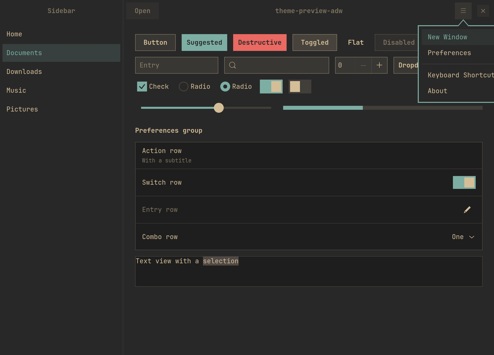
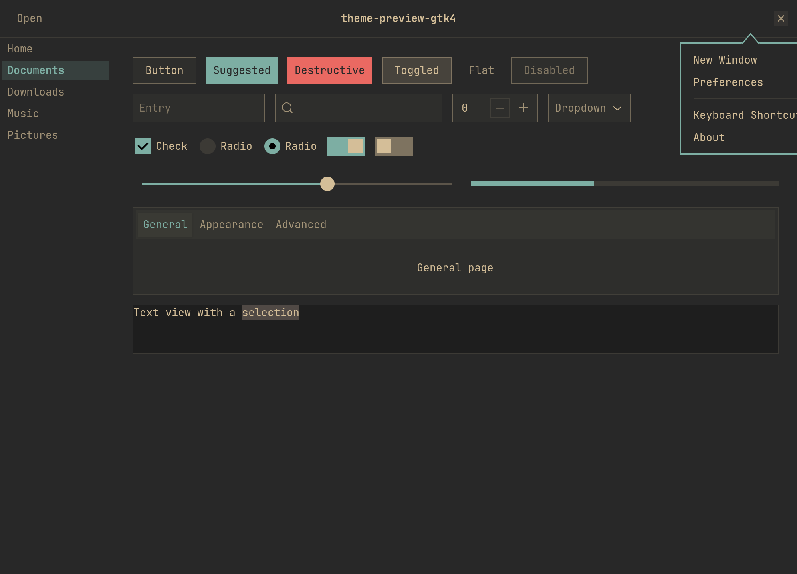
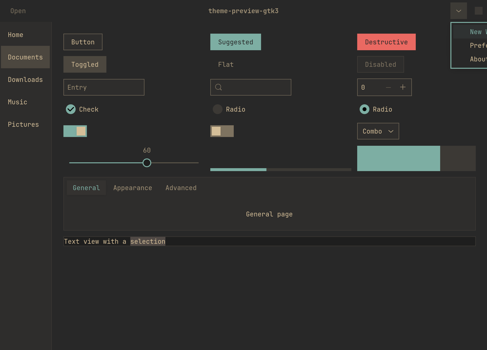

# Omarchy Gruvbox GTK

A GTK3, GTK4 and libadwaita theme that matches [Omarchy](https://omarchy.org)'s
Gruvbox theme: the exact same palette, and Omarchy 4's flat, square look.



| GTK4 | GTK3 |
| --- | --- |
|  |  |

## What it changes

It's a fork of Fausto-Korpsvart's
[Gruvbox-GTK-Theme](https://github.com/Fausto-Korpsvart/Gruvbox-GTK-Theme)
(medium variant), adjusted to match Omarchy:

- **Palette.** Every color comes from Omarchy's
  `themes/gruvbox/colors.toml`, which is gruvbox-*material*: `#d4be98` text
  on `#282828`, `#7daea3` accent, `#504945` selection. Upstream uses classic
  gruvbox (`#fbf1c7` text) and, in dark mode, the darker light-mode shades
  for error, warning and suggested buttons.
  See [`_color-palette-omarchy.scss`](src/sass/_color-palette-omarchy.scss).
- **Square corners.** Omarchy runs Hyprland with `rounding = 0`, so every
  radius is 0. Radio buttons and slider knobs stay round, like in Omarchy's
  shell.
- **Omarchy's control style**, taken from the `[controls]` defaults in
  Omarchy's `shell.toml`: a 4% foreground fill with a 1px foreground border at
  rest, 8% fill on hover, 18% fill with no border when selected or toggled,
  and an accent border on focused entries. Switches are square, as Omarchy's
  are when corners are sharp.
- **Popups like Omarchy's.** Menus, popovers and dialogs use the window
  background with a 2px accent border (Hyprland's active border) and no
  shadow. Tooltips get a 1px foreground border.
- **No material ripples**, and no drop shadows on buttons.

## Install

Needs `sassc` (`sudo pacman -S sassc`).

```sh
git clone https://github.com/chayotesudado/omarchy-gruvbox-gtk
cd omarchy-gruvbox-gtk
./install.sh
```

This builds the theme and then:

1. installs it to `~/.local/share/themes/Omarchy-Gruvbox`;
2. writes the libadwaita layer to `~/.config/gtk-4.0/gtk.css`, after backing
   up any existing file to `gtk.css.before-omarchy-gruvbox`;
3. sets `gtk-theme` to `Omarchy-Gruvbox` and `color-scheme` to `prefer-dark`.

Restart open GTK apps afterwards.

`./install.sh --uninstall` removes the theme, restores the backed-up
`gtk.css`, and resets `gtk-theme`.

### Why two parts?

Libadwaita apps (Nautilus and most GNOME apps) ignore GTK themes entirely.
The only thing they read is `~/.config/gtk-4.0/gtk.css`, so the theme ships a
small separate stylesheet for that: [`src/main/libadwaita/gtk.scss`](src/main/libadwaita/gtk.scss).
GTK loads it above libadwaita's own styles, so it overrides colors, corners
and borders without fighting selector specificity. It's built from the same
palette as the full theme, so the two can't drift apart.

## Development

```sh
./build.sh                         # build into ./build/Omarchy-Gruvbox
./build.sh --install               # ...and copy to ~/.local/share/themes
tools/preview.py gtk4|gtk3|adw     # widget gallery
tools/screenshot.sh adw out.png --popover   # screenshot it (Hyprland)
```

The Omarchy-specific parts live in:

- `src/sass/_color-palette-omarchy.scss`: the palette
- `src/sass/_variables.scss`: radii
- `src/sass/_colors.scss`: semantic colors and state alphas
- `src/sass/gtk/_drawing-{3,4}.0.scss`: button and entry states
- `src/sass/gtk/_omarchy-{3,4}.0.scss`: popups, tooltips, action buttons
- `src/main/libadwaita/gtk.scss`: the libadwaita layer

Everything else under `src/` is upstream's GTK3/GTK4 source, unchanged, and
the first commit in this repo is that pristine import. Run
`git diff <first commit>` to see every change made for Omarchy.

## Limitations

- Dark only, since Omarchy's Gruvbox is dark.
- It matches Omarchy's **Gruvbox** theme. Switching Omarchy themes doesn't
  change GTK apps.

## License

GPL-3.0, same as upstream. Based on
[Gruvbox-GTK-Theme](https://github.com/Fausto-Korpsvart/Gruvbox-GTK-Theme) by
Fausto-Korpsvart, which is based on Vinceliuice's Colloid theme. Gruvbox
itself is by [morhetz](https://github.com/morhetz/gruvbox). Not affiliated
with Omarchy.
